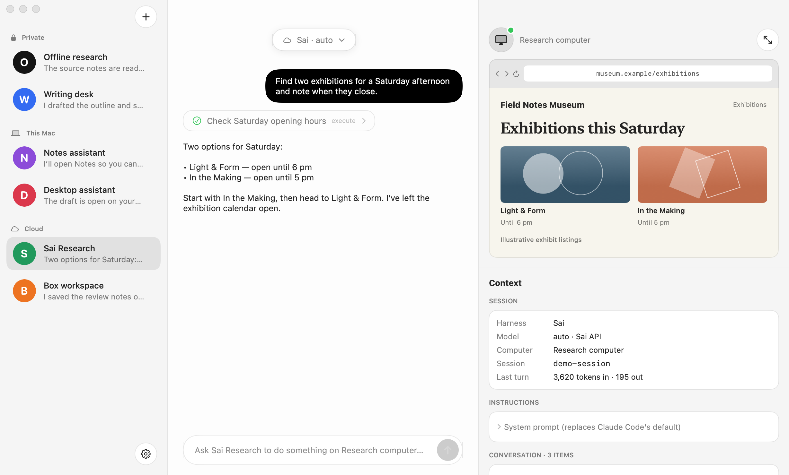

# Agent S desktop apps

Run a computer-use agent in a lightweight Linux VM on your machine. The desktop apps also support cloud computers through Sai and, on macOS, Simular Box.

| Platform | Setup and capabilities |
| --- | --- |
| macOS | [Build and run Agent S for macOS](macos/README.md) on Apple Silicon with macOS 14 or later. Choose a Linux VM with Ollama or OpenRouter, use your Mac apps with approvals, or connect to Sai or Box. |
| Windows | [Agent S for Windows development preview](https://github.com/simular-ai/Agent-S/pull/268) includes a private Hyper-V VM and Sai cloud support. |

*The Sai computer panel shows an illustrative desktop.*

[Repository license](../LICENSE)
