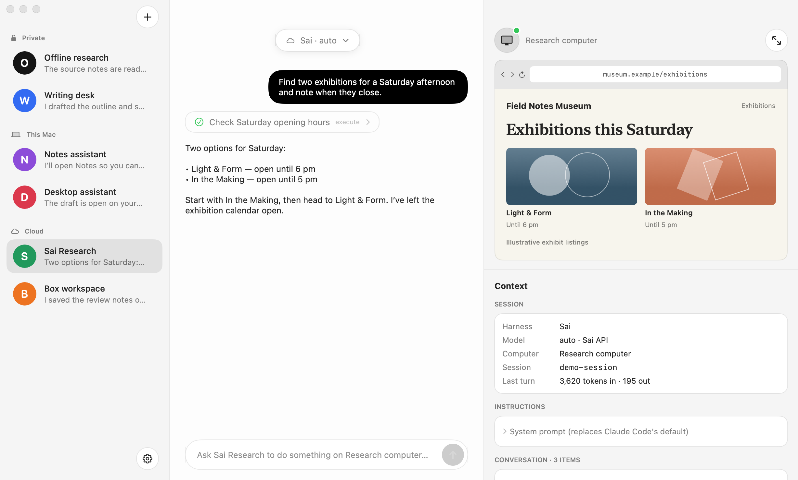
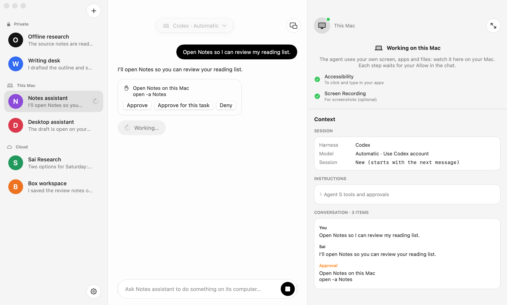

# Agent S for Mac

Agent S is a native macOS app for computer-use agents. Choose a Linux VM on your Mac,
let an agent work in your Mac apps with approvals, or connect to a Sai computer or
Simular Box. Each agent has its own conversation and can pick up where it left off.




*Demo conversation with the cloud computer and session context beside the chat. The computer panel shows an illustrative desktop.*

<details>
<summary>See an approval on This Mac</summary>



</details>

## Build and run

Agent S requires an Apple Silicon Mac with macOS 14 or later. To build from source, install
Xcode with Swift 6.2 or later. Build and open the app from the repository root.

```sh
cd app/macos
./scripts/bundle.sh
open "build/Agent S.app"
```

The build script signs the app for local development by default. Run `./scripts/test.sh`
from `app/macos/` to run the Swift test suite.

Closing the last window keeps Agent S, active turns, and the VM running. Click Agent S in
the Dock to reopen the window, or use **Quit Agent S** to exit the app.

The Computer panel shows pending requests and open work first. Check items under
**Open work** to run them together in one chat turn or delete them from memory.

## Choose how an agent runs

On first launch, pick a harness and model for **Sandbox on This Mac**, then click
**Set up agent** to download and start the sandbox. If you choose **Ollama**, the
setup screen links to the Mac installer and lets you download the selected model.
The new chat offers sample tasks. Click one to fill the composer, where you can
edit it before sending.

Click **+** in the sidebar, name the agent, and select **Runs**. For **Cloud Computer**, choose a
computer first. Choose the harness and **Provider** when prompted. To change an existing
agent's configuration, right-click it and choose **Agent Settings…**. Each **Sandbox on This Mac**
agent keeps the provider selected when it was created. To use a different provider,
create a new agent.

| Runs on | Harness | Model provider |
| --- | --- | --- |
| **Sandbox on This Mac** · Linux VM | Claude Code | Ollama, OpenRouter, Claude Code account |
| **Sandbox on This Mac** · Linux VM | Codex | Ollama, OpenRouter, Codex account |
| **Sandbox on This Mac** · Linux VM | DeepSeek | Ollama, OpenRouter |
| **This Mac** · your Mac apps and files | Claude Code | Ollama, OpenRouter, Claude Code account |
| **This Mac** · your Mac apps and files | Codex | Codex account |
| **This Mac** · your Mac apps and files | DeepSeek | Ollama, OpenRouter |
| **Cloud Computer** · Sai computer | Sai | Sai API, with models available on your Sai account |
| **Cloud Computer** · Simular Box | Claude Code | Ollama, OpenRouter, Claude Code account |
| **Cloud Computer** · Simular Box | Codex | Ollama, OpenRouter, Codex account |
| **Cloud Computer** · Simular Box | DeepSeek | Ollama, OpenRouter |

The display button beside the chat opens the computer panel, where you can watch the
Linux VM or cloud computer and see the agent's session context.

### Sandbox on This Mac

1. If the sandbox hasn’t been set up, click **Set up** in the chat or
   **Settings → Computer → Set up the computer**. Setup downloads a Debian 13 ARM64
   image and creates a sparse 32 GB disk that grows with use.
2. When creating the agent, set **Runs** to **Sandbox on This Mac** and select a **Provider**.
   For **Ollama**, start [Ollama](https://ollama.com/) 0.14 or later on your Mac and
   select or download a local model in **Agent Settings… → Model**. The default is
   `gemma4`. For **OpenRouter**, add your API key and choose a hosted model.
3. Turn on the VM from the chat or computer panel. The first boot needs internet access
   to install the desktop and tools in the VM. Wait for setup to finish, then send a message.
   One agent can use the shared Linux desktop at a time.

Choose **2 GB**, **4 GB**, or **6 GB** during onboarding or in **Settings → Computer → Memory**.
The default is **2 GB**. Changes apply when you start a powered-off sandbox. Ollama uses
memory on the Mac separately, so budget host memory for the model too. In the computer panel, use **Take over**
to send mouse and keyboard input to the VM.

On Apple silicon, quitting Agent S saves the running sandbox when the Mac and VM
configuration support it. Reopen Agent S to resume open apps and windows. **Turn off**
shuts down the sandbox, and settings such as a new memory allocation apply on the next
full start. The sandbox disk keeps files and sign-ins across either action.

Chromium stays open between tasks while the sandbox is running. To use a subscription,
select **Use Claude Code account** or **Use Codex account** as the provider. Start the
sandbox and choose **Sign in** above the composer.

- **Codex** shows a one-time code in Agent S and opens your Mac browser. Enter the code
  there. Agent S detects when sign-in completes, and Codex stores its credentials in
  the sandbox. An older Codex version may show the code in the Computer panel.
  [Enable device-code sign-in for Codex](https://learn.chatgpt.com/docs/auth#login-on-headless-devices)
- **Claude Code** opens its sign-in page in your Mac’s browser. Finish signing in
  there and return to Agent S. Claude Code stores its credentials in the sandbox.

### This Mac

1. Install the CLI you chose for the agent. [Claude Code setup](https://code.claude.com/docs/en/setup) · [Codex CLI setup](https://learn.chatgpt.com/docs/cli) · [DeepSeek Harness setup](#deepseek-harness)
2. Install simulang with `npm install -g @simular-ai/simulang`.
3. In **Settings → Mac Permissions**, allow **Accessibility**. Enable **Screen Recording**
   if you want the agent to take screenshots. These permissions apply to Agent S and are
   shared across its agents. Screen Recording may require reopening the app.
4. For on-device inference, start Ollama on your Mac. Set **Runs** to **This Mac**,
   select **Claude Code** or **DeepSeek** with **Ollama**, and choose a local model.
5. Send a message and review proposed actions in the chat or in the floating **Agent Activity**
   panel while another app is in front. Read-only observations can run automatically.
   **Approve for this task** approves the remaining actions in the current turn.
   You can stop a turn from either window.

### Sai computer

Create a **Cloud Computer → Sai computer** agent. Add your Sai API key in **Settings → Accounts**
or in the new-agent form, then choose a computer and model from your Sai account.
Sending a message can wake a sleeping Sai cloud computer. You can also use **Wake computer**
in the computer panel when Sai makes that action available. For a computer you enrolled,
make sure its Sai runtime is online.
[Sai API keys](https://platform.simular.ai/api-keys) · [Sai computer lifecycle](https://platform.simular.ai/documentation/concepts/computers)

### Simular Box

Create a **Cloud Computer → Simular Box** agent. Add your personal Box key in **Settings → Accounts**
and leave the **Box** field empty for your default Box, or enter the name of a specific Box.
The selected CLI runs on your Mac and uses the Box's tools.
[Box access keys](https://box.simular.ai/access)

Install Claude Code or Codex using the links above, or follow the DeepSeek setup below.

### DeepSeek Harness

For **This Mac** and **Simular Box**, use Node.js 24.9 or later and install the version expected by Agent S.

```sh
npm install -g @deepseek-ai/dsh@0.2.2-rc.5
```

### Model setup

- **Ollama** runs on the Mac and is needed when you select it as the provider. You can
  check the connection in **Settings → Ollama** and download a model in **Agent Settings…**.
- **OpenRouter** requires an API key in **Settings → Accounts**. Search by model or provider
  in the OpenRouter model settings or enter a model ID. **Request Zero Data Retention (ZDR)**
  applies to all OpenRouter agents. [OpenRouter keys](https://openrouter.ai/keys)
- **Claude Code account** and **Codex account** use automatic model selection. After
  creating the agent, choose **Sign in with Claude Code…** or **Sign in with ChatGPT…**.
  The installed CLI handles sign-in in an app-specific profile.

## Permissions and data

- Choose **Ollama** and a local model for on-device inference. This works with
  **Sandbox on This Mac** and with **This Mac** when the harness is **Claude Code** or **DeepSeek**.
- **Sandbox on This Mac** agents share the guest, browser, and files. The guest can reach the internet,
  shares the clipboard, and can read and write the app's shared folder at
  `~/Library/Application Support/Agent S/share` (`/mnt/sai` in the VM).
  Harness commands run in the VM with per-tool approval disabled. Sandbox CLI sign-ins
  live in the guest and are accessible to other agents using that sandbox.
- **This Mac** uses the Mac's apps, Terminal, and files with approvals for actions.
- Hosted providers receive prompts and tool results sent to the model, which can include
  web pages, file contents, and screenshots. Agent S stores the OpenRouter key in the
  Mac's Keychain and forwards guest model requests through the app's proxy.
- **Sai** receives tasks and runs them on the selected computer. **Simular Box**
  receives tool calls and their inputs even when the agent uses Ollama. A hosted
  model provider can also receive Box tool results used as model context. The app
  identifies itself when connecting to Sai and Simular Box.
- The app keeps its chat history and agent settings in
  `~/Library/Application Support/Agent S`. Sai, Box, and OpenRouter API keys are
  stored in the macOS Keychain.

## Source layout

- [Sources/AgentS](Sources/AgentS) contains the SwiftUI app, agent sessions, provider
  integrations, and Virtualization framework runtime.
- [Sources/AgentSCore](Sources/AgentSCore) contains mode and provider rules, guest
  setup, harness commands, and stream parsers.
- [Tests/AgentSCoreTests](Tests/AgentSCoreTests) contains the Swift tests.

## Publishing

The bundle identifier is `ai.simular.agent-s`. The full macOS app is intended for
direct distribution as a Developer ID–signed, notarized DMG. A Mac App Store build
would need to meet Apple's sandbox requirements for its automation features.
[Apple's macOS distribution options](https://developer.apple.com/macos/distribution/)

1. Install the organization's **Developer ID Application** signing identity and store
   notarization credentials in a Keychain profile. From `app/macos`, run:

   ```sh
   xcrun notarytool store-credentials agent-s-notary
   SIGN_IDENTITY='Developer ID Application: Your Organization (TEAMID)' \
     NOTARY_KEYCHAIN_PROFILE=agent-s-notary ./scripts/release.sh
   ```

   The script builds and signs the app and disk image, submits the DMG to Apple, and
   staples the approved ticket. It writes the versioned DMG and SHA-256 checksum to
   `build/`. [Apple's notarization workflow](https://developer.apple.com/documentation/security/customizing-the-notarization-workflow)
2. Verify Gatekeeper on a clean Apple Silicon Mac. Test a fresh install and upgrade,
   including macOS permissions, sandbox startup, and Sai and Box sign-in. The app
   verifies the pinned Debian archive before unpacking. Publish a privacy policy that
   covers the modes shipped in the release.
3. Verify the account integrations for the intended distribution. OpenAI documents
   **Sign in with ChatGPT** for commercial or hosted integrations in place of the
   current Codex App Server authentication. Anthropic's terms govern the use of
   Claude Code in a product. [Codex authentication](https://learn.chatgpt.com/docs/app-server#auth-endpoints) · [Claude Code terms](https://code.claude.com/docs/en/legal-and-compliance)
4. Attach the verified DMG and checksum to a GitHub Release for the tested commit.

[Repository license](../../LICENSE)
