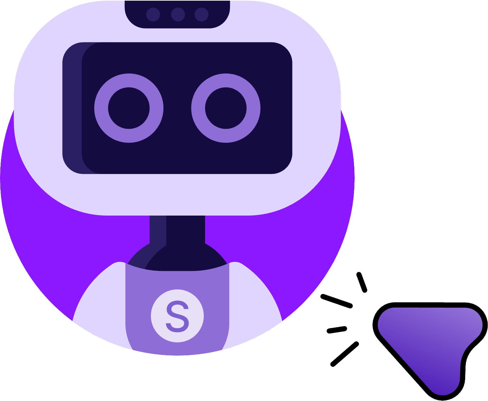

<h1 align="center">
   Agent S2.5
</h1>

Agent S2.5 was released in `gui-agents` v0.2.5. It is a simpler and faster version of [Agent S2](../s2/README.md). The current `agent_s` command runs [Agent S3](../s3/README.md); to run Agent S2.5, use `python -m gui_agents.s2_5.cli_app` as shown below.

## 🎯 Results

<div align="center">
  <table border="0" cellspacing="0" cellpadding="5">
    <tr>
      <th>Benchmark</th>
      <th>Agent S2.5</th>
      <th>Previous SOTA</th>
    </tr>
    <tr>
      <td>OSWorld Verified (100 step)</td>
      <td><b>56.0%</b></td>
      <td>53.1%</td>
    </tr>
    <tr>
      <td>OSWorld Verified (50 step)</td>
      <td><b>54.2%</b></td>
      <td>50.6%</td>
    </tr>
<!--     <tr>
      <td>WindowsAgentArena</td>
      <td>29.8%</td>
      <td>19.5% (NAVI)</td>
    </tr>
    <tr>
      <td>AndroidWorld</td>
      <td>54.3%</td>
      <td>46.8% (UI-TARS)</td>
    </tr> -->
  </table>
</div>


## 🛠️ Installation & Setup

### Prerequisites
- **Single Monitor**: Our agent is designed for single monitor screens
- **Security**: The agent runs Python code to control your computer - use with care
- **Supported Platforms**: Linux, Mac, and Windows


### Installation
To install Agent S2.5 without cloning the repository, run
```bash
pip install gui-agents
```
If you would like to test Agent S2.5 while making changes, clone the repository and install using
```
pip install -e .
```

### API Configuration

#### Option 1: Environment Variables
Add to your `.bashrc` (Linux) or `.zshrc` (MacOS):
```bash
export OPENAI_API_KEY=<YOUR_API_KEY>
export ANTHROPIC_API_KEY=<YOUR_ANTHROPIC_API_KEY>
export HF_TOKEN=<YOUR_HF_TOKEN>
```

#### Option 2: Python Script
```python
import os
os.environ["OPENAI_API_KEY"] = "<YOUR_API_KEY>"
```

### Supported Models
We support Azure OpenAI, Anthropic, Gemini, Open Router, and vLLM inference. See [models.md](../../models.md) for details.

### Grounding Models (Required)
For optimal performance, we recommend [UI-TARS-1.5-7B](https://huggingface.co/ByteDance-Seed/UI-TARS-1.5-7B) hosted on Hugging Face Inference Endpoints or another provider. See [Hugging Face Inference Endpoints](https://huggingface.co/learn/cookbook/en/enterprise_dedicated_endpoints) for setup instructions.

## 🚀 Usage


> ⚡️ **Recommended Setup:**  
> For the best configuration, we recommend using **OpenAI gpt-5-2025-08-07** as the main model, paired with **UI-TARS-1.5-7B** for grounding.  


### CLI

Run Agent S2.5 with the required parameters:

```bash
python -m gui_agents.s2_5.cli_app \
    --provider openai \
    --model gpt-5-2025-08-07 \
    --ground_provider huggingface \
    --ground_url http://localhost:8080 \
    --ground_model ui-tars-1.5-7b \
    --grounding_width 1920 \
    --grounding_height 1080
```

#### Required Parameters
- **`--provider`**: Main generation model provider (e.g., openai, anthropic, etc.) - Default: "openai"
- **`--model`**: Main generation model name (e.g., gpt-5-2025-08-07) - Default: "gpt-5-2025-08-07"
- **`--ground_provider`**: The provider for the grounding model - **Required**
- **`--ground_url`**: The URL of the grounding model - **Required**
- **`--ground_model`**: The model name for the grounding model - **Required**
- **`--grounding_width`**: Width of the output coordinate resolution from the grounding model - **Required**
- **`--grounding_height`**: Height of the output coordinate resolution from the grounding model - **Required**

#### Optional Parameters
- **`--model_temperature`**: The temperature to fix all model calls to (necessary to set to 1.0 for models like o3 but can be left blank for other models)

#### Grounding Model Dimensions
The grounding width and height should match the output coordinate resolution of your grounding model:
- **UI-TARS-1.5-7B**: Use `--grounding_width 1920 --grounding_height 1080`
- **UI-TARS-72B**: Use `--grounding_width 1000 --grounding_height 1000`

#### Optional Parameters
- **`--model_url`**: Custom API URL for main generation model - Default: ""
- **`--model_api_key`**: API key for main generation model - Default: ""
- **`--ground_api_key`**: API key for grounding model endpoint - Default: ""
- **`--max_trajectory_length`**: Maximum number of image turns to keep in trajectory - Default: 8
- **`--enable_reflection`**: Enable reflection agent to assist the worker agent - Default: True

### `gui_agents` SDK

First, we import the necessary modules. `AgentS2_5` is the main agent class for Agent S2.5. `OSWorldACI` is our grounding agent that translates agent actions into executable python code.
```python
import pyautogui
import io
from gui_agents.s2_5.agents.agent_s import AgentS2_5
from gui_agents.s2_5.agents.grounding import OSWorldACI

# Load in your API keys.
from dotenv import load_dotenv
load_dotenv()

current_platform = "linux"  # "darwin", "windows"
```

Next, we define our engine parameters. `engine_params` is used for the main agent, and `engine_params_for_grounding` is for grounding. For `engine_params_for_grounding`, we support custom endpoints like HuggingFace TGI, vLLM, and Open Router.

```python
engine_params = {
  "engine_type": provider,
  "model": model,
  "base_url": model_url,           # Optional
  "api_key": model_api_key,        # Optional
  "temperature": model_temperature # Optional
}

# Load the grounding engine from a custom endpoint
ground_provider = "<your_ground_provider>"
ground_url = "<your_ground_url>"
ground_model = "<your_ground_model>"
ground_api_key = "<your_ground_api_key>"

# Set grounding dimensions based on your model's output coordinate resolution
# UI-TARS-1.5-7B: grounding_width=1920, grounding_height=1080
# UI-TARS-72B: grounding_width=1000, grounding_height=1000
grounding_width = 1920  # Width of output coordinate resolution
grounding_height = 1080  # Height of output coordinate resolution

engine_params_for_grounding = {
  "engine_type": ground_provider,
  "model": ground_model,
  "base_url": ground_url,
  "api_key": ground_api_key,  # Optional
  "grounding_width": grounding_width,
  "grounding_height": grounding_height,
}
```

Then, we define our grounding agent and Agent S2.5.

```python
grounding_agent = OSWorldACI(
    platform=current_platform,
    engine_params_for_generation=engine_params,
    engine_params_for_grounding=engine_params_for_grounding,
    width=1920,  # Optional: screen width
    height=1080  # Optional: screen height
)

agent = AgentS2_5(
    engine_params,
    grounding_agent,
    platform=current_platform,
    max_trajectory_length=8,  # Optional: maximum image turns to keep
    enable_reflection=True     # Optional: enable reflection agent
)
```

Finally, let's query the agent!

```python
# Get screenshot.
screenshot = pyautogui.screenshot()
buffered = io.BytesIO() 
screenshot.save(buffered, format="PNG")
screenshot_bytes = buffered.getvalue()

obs = {
  "screenshot": screenshot_bytes,
}

instruction = "Close VS Code"
info, action = agent.predict(instruction=instruction, observation=obs)

exec(action[0])
```

Refer to [`cli_app.py`](cli_app.py) for more details on how the inference loop works.

### OSWorld

To deploy Agent S2.5 in OSWorld, follow the [OSWorld Deployment instructions](../../osworld_setup/s2_5/OSWorld.md).

